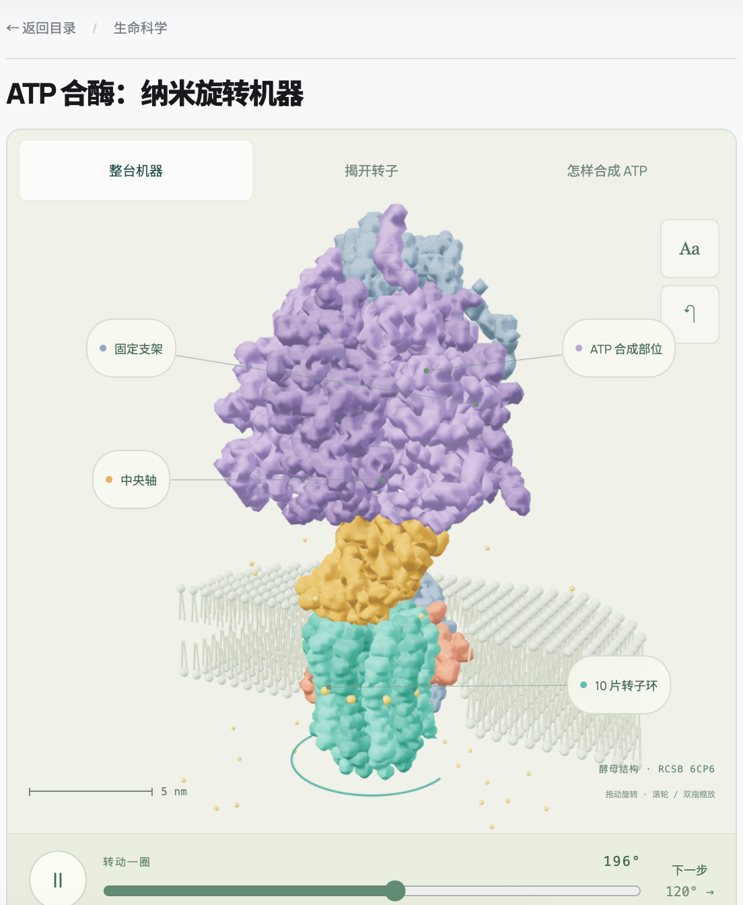
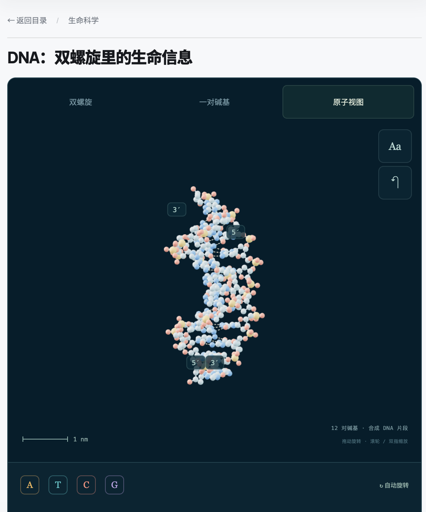

# Biomolecular 3D

**用 RCSB PDB 的真实分子坐标，制作能旋转、能拆解、能探索的三维科普网页。**

A Codex skill for interactive 3D models of proteins, DNA, RNA, and molecular complexes, built from RCSB PDB coordinates.

从 DNA 的信息存储，到血红蛋白的氧气运输、核糖体的蛋白质制造、植物的光合作用：把看不见的分子世界，变成学生可以亲手观察的互动内容。

## RCSB 里有什么可以用？

[RCSB PDB](https://www.rcsb.org/pages/about-us/index) 提供蛋白质、DNA、RNA 及其复合物的三维结构数据。它保存的是分子中原子的位置、分子链与组成等信息，可以据此构建不同精细程度的 3D 模型。

### 主要分子类型

| 数据类型 | 里面有什么 | 可以讲什么 |
| --- | --- | --- |
| **蛋白质 · 酶** | 消化酶、溶菌酶、DNA 聚合酶等 | 分子形状为什么影响功能；活性位点如何与底物配合 |
| **蛋白质 · 运输与通道** | 血红蛋白、水通道、离子通道等 | 氧气如何被携带；细胞膜为什么能选择性通行 |
| **蛋白质 · 识别与信号** | 抗体、受体、视紫红质等 | 免疫识别、细胞通信、眼睛如何感受光 |
| **蛋白质 · 马达与支架** | 马达蛋白、肌动蛋白、微管蛋白等 | 细胞如何运输货物、改变形状、建立内部骨架 |
| **DNA** | 双螺旋、不同构象的片段、与蛋白结合的 DNA | 碱基配对、遗传信息、双链方向、DNA 的包装与识别 |
| **RNA** | tRNA、rRNA、核酶等 | RNA 如何从一条链折叠成功能结构，参与蛋白质制造 |
| **大型复合物** | 核糖体、核小体、光合复合物、病毒衣壳等 | 多个分子如何组成一台机器，完成单个分子做不到的事 |
| **伴随组分** | 糖链、药物、ATP、色素、金属离子等 | 糖基化、能量转换、光吸收、药物结合和金属参与的功能 |

这是一种方便选题的分组，类别会交叉；药物、ATP、色素和金属离子本身不属于生物大分子。RCSB 同时提供实验结构和计算结构模型的访问，使用时需要区分来源。[官方数据介绍](https://www.rcsb.org/pages/about-us/index)

## 可以做成哪些互动科普？

下面列出 **12 个可以继续制作的方向**。每个都附上已核对的真实结构入口；“互动设计”是基于这些数据可开展的教学创意，页面需要结合目标项目实现。

| 科普选题 | 真实结构入口 | 可以让学生亲手做什么 |
| --- | --- | --- |
| **血液里的氧气运输车** | 血红蛋白 [4HHB](https://www.rcsb.org/structure/4HHB) | 旋转观察四个亚基，逐个找到血红素和铁；用结合示意理解氧气运输。该条目是脱氧状态 |
| **会发绿光的蛋白质** | 绿色荧光蛋白 [1GFL](https://www.rcsb.org/structure/1GFL) | 从外部桶状结构切到内部发色团，切换激发/发光的教学示意，探索“发光核心藏在哪里” |
| **细胞膜上的水分子专用门** | 水通道蛋白 [1FQY](https://www.rcsb.org/structure/1FQY) | 沿孔道观察内部结构，放大关键位置，用有机制依据的示意比较不同粒子的通行 |
| **眼泪中的防御工具** | 溶菌酶 [1LYZ](https://www.rcsb.org/structure/1LYZ) | 寻找表面沟槽和活性位点，结合另选的底物复合物展示识别过程，理解形状与功能的关系 |
| **抗体为什么像一个 Y？** | 免疫球蛋白 [1IGT](https://www.rcsb.org/structure/1IGT) | 按链着色，选择两端与柄部，标出抗原结合区域，观察不同部件的空间关系 |
| **两米长的 DNA 怎样收进细胞核？** | 核小体 [1AOI](https://www.rcsb.org/structure/1AOI) | 在完整结构、DNA 和组蛋白之间切换，沿 DNA 路径追踪缠绕，比较展开与包装的示意 |
| **RNA 也会折成立体形状** | 转运 RNA [1EHZ](https://www.rcsb.org/structure/1EHZ) | 对照二维结构图和三维折叠，找到反密码子与氨基酸连接端，观察它们相隔多远 |
| **细胞里的蛋白质工厂** | 核糖体 [4V9D](https://www.rcsb.org/structure/4V9D) | 分别高亮蛋白与 RNA，观察大小亚基和 tRNA 位置，设计分步骤的翻译过程示意 |
| **细胞骨架的积木** | α/β 微管蛋白 [1JFF](https://www.rcsb.org/structure/1JFF) | 区分两种亚基，再依据装配资料搭建微管示意；原条目来自稳定化片层，不直接当作完整天然微管 |
| **细胞里运货的小马达** | 驱动蛋白结构域 [2KIN](https://www.rcsb.org/structure/2KIN) | 近看马达结构域与核苷酸结合区；如要制作沿微管行走，另选含微管的复合物并补充机制资料 |
| **植物的分子级太阳能装置** | 光系统 II–捕光复合物 [5XNL](https://www.rcsb.org/structure/5XNL) | 在蛋白框架与色素之间切换，高亮捕光天线，分层展示能量传递的教学路径 |
| **眼睛怎样把光变成信号？** | 视紫红质 [1F88](https://www.rcsb.org/structure/1F88) | 找到跨膜螺旋与视黄醛，结合其他状态结构和机制资料，对照光刺激前后的变化 |

这些主题的教学背景可以从 RCSB 官方的 [PDB-101 Molecule of the Month](https://pdb101.rcsb.org/motm/motm-by-title) 继续查阅。单个条目提供特定状态下的结构，反应过程与运动需要额外的机制依据。

## 拿到的不只是一个外形

| 数据与资料 | 能用来做什么 |
| --- | --- |
| **原子坐标与元素身份** | 制作原子球、球棍、骨架或表面视图；保留真实相对位置与尺度 |
| **分子链、残基与序列** | 分链着色，点击定位，突出某个片段，联动序列与三维位置 |
| **配体、糖链与离子** | 找到发色团、结合口袋、金属中心等功能相关位置 |
| **生物装配体与对称关系** | 在核对装配体后，展示多亚基机器、环形结构和衣壳组织 |
| **结构方法与质量信息** | 说明结构来自何种实验或预测，结合缺失区域、分辨率或置信度解释细节取舍 |
| **原始论文与相关条目** | 对照不同构象、结合状态或物种，给动画和功能说明寻找依据 |

具体字段与可用资料依条目而异。化学键需要结合拓扑等资料处理；工作原理、运动轨迹、速度、光学效果等也需要另行建模。

## 这个 Skill 能帮你做什么？

- **从真实结构开始**：给一个 PDB ID、RCSB 链接或教学主题，选择结构、核对组成、下载并保留来源记录。
- **设计合适的 3D 表示**：按目标选择原子、骨架、分链外形或轻量蛋白包络，接入现有 Three.js 项目。
- **把结构变成可探索的内容**：旋转缩放、部件选择、高亮、分层观察、剖面、标签与真实尺度标尺。
- **加入有依据的教学过程**：状态对比、暂停、单步、过程示意，以及适合学生观察的问题。
- **交付可运行的页面或模型**：模型与源码、来源说明、本地预览，以及与交付规模相称的运行检查。

这是一套给 AI 使用的制作流程和数据脚本。已有的网页框架可以继续沿用；大型复杂结构也可以选择成熟的 Mol* 等工具。

## 效果预览

<table>
  <tr>
    <th>ATP 合酶：纳米旋转机器</th>
    <th>DNA：双螺旋里的生命信息</th>
  </tr>
  <tr>
    <td valign="top"></td>
    <td valign="top"></td>
  </tr>
</table>

WonderLab X 自制页面截图。结构来源：[ATP 合酶 6CP6](https://www.rcsb.org/structure/6CP6)（[研究论文](https://doi.org/10.1126/science.aas9699)）、[DNA 1BNA](https://www.rcsb.org/structure/1BNA)（[研究论文](https://doi.org/10.1073/pnas.78.4.2179)）。颜色与动态效果服务于教学；示例页面源码不包含在本仓库中。

## 交给 AI 的一句话

```text
用 $biomacromolecule-3d，把 RCSB 的 1AOI 做成“DNA 怎样收进细胞核”的互动科普页。
面向小学高年级到初中，支持旋转缩放、分别观察 DNA 和组蛋白、追踪 DNA 缠绕路径，
保留真实坐标与尺度，标注数据来源和教学示意，先给本地预览。
```

也可以直接给教学目标：

```text
用 $biomacromolecule-3d，从 RCSB 里选择适合解释“植物怎样利用阳光”的结构，
做一个分层观察蛋白质和色素的三维页面，并说明哪些效果是教学示意。
```

## 来源与制作原则

数据优先从 [RCSB 文件服务](https://www.rcsb.org/docs/programmatic-access/file-download-services) 下载 PDBx/mmCIF，保留 PDB ID、所选装配体、下载 URL、获取时间、SHA256 和原始论文。

所有链沿用同一坐标变换，Å → nm 乘以 0.1；依据结构选择表示方式。蛋白 Cα 包络、全原子结构和实验密度有不同用途，静态坐标与教学动画也需要分别说明。

默认先提供本地预览，部署按用户请求执行。技术细节见 [技能入口](SKILL.md)、[数据与几何](references/data-and-geometry.md) 和 [验证与项目接入](references/verification-and-integration.md)。

## 安装 Skill

### 方法一：让 Codex 安装

在 Codex 中输入：

```text
用 $skill-installer 安装这个 GitHub 仓库根目录的 skill：
https://github.com/rockeymen/biomacromolecule-3d
安装名称使用 biomacromolecule-3d。
```

支持安装器脚本的 Codex 环境也可运行：

```bash
python3 "${CODEX_HOME:-$HOME/.codex}/skills/.system/skill-installer/scripts/install-skill-from-github.py" \
  --repo rockeymen/biomacromolecule-3d \
  --path . \
  --name biomacromolecule-3d
```

安装器脚本随 Codex 环境提供，不属于本仓库；没有该脚本时使用下面的 Git 方法。安装器遇到同名目录会停止，不会覆盖已有 skill。

### 方法二：Git 安装

需要本机已安装 Git。在终端执行：

```bash
mkdir -p "${CODEX_HOME:-$HOME/.codex}/skills"
git clone https://github.com/rockeymen/biomacromolecule-3d.git \
  "${CODEX_HOME:-$HOME/.codex}/skills/biomacromolecule-3d"
```

安装后的目录应为：

```text
~/.codex/skills/biomacromolecule-3d/
├── SKILL.md
├── agents/openai.yaml
├── scripts/
└── references/
```

设置了 `CODEX_HOME` 时，以该目录下的 `skills/` 为准。安装后在下一轮对话调用；若列表尚未刷新，重新打开 Codex 后再试。

**更新 Git 安装：**

```bash
git -C "${CODEX_HOME:-$HOME/.codex}/skills/biomacromolecule-3d" pull --ff-only
```

若之前是手动复制或安装器安装、目录里没有 `.git`，先备份并移走原目录，再重新安装。已有修改先保留，避免直接覆盖。

## 随附脚本与依赖

安装 skill 本身只需要文件；执行坐标提取时才需要 Python 环境，生成蛋白包络时才需要 Node.js 与目标项目的 Three.js。

| 脚本 | 功能 | 依赖 |
| --- | --- | --- |
| `scripts/fetch_structure.py` | 下载条目或已展开装配体的 mmCIF，保存来源与 SHA256 | Python 3 标准库、网络 |
| `scripts/extract_coordinates.py` | 提取全重原子、蛋白 Cα 或核酸骨架，保留身份并统一转换到 nm | Python 3、gemmi、numpy |
| `scripts/build_ca_surface.mjs` | 按链生成轻量蛋白 Cα 包络与元数据 | Node.js、目标项目已有的 Three.js |

建议在独立虚拟环境安装 Python 依赖：

```bash
cd "${CODEX_HOME:-$HOME/.codex}/skills/biomacromolecule-3d"
python3 -m venv .venv
.venv/bin/python -m pip install -r requirements.txt

.venv/bin/python scripts/fetch_structure.py 1BNA --out temp/1bna
.venv/bin/python scripts/extract_coordinates.py \
  --input temp/1bna/1BNA.cif \
  --representation atoms \
  --out temp/1bna/atoms.json
```

以上生成可用于建模的坐标 JSON；页面、化学键拓扑和教学交互由 Codex 根据目标项目继续实现。脚本遇到已有输出会停止，重复运行请换一个输出目录或文件名。

`ca` 仅用于蛋白质；`nucleic` 只输出 P/C4′ 骨架采样，不包含完整碱基或配对。蛋白包络的构建命令与解码格式见 [SKILL.md](SKILL.md) 和 [数据与几何契约](references/data-and-geometry.md)。

## 许可与致谢

本仓库原创 skill、脚本、说明及作者提供的示例截图采用 [MIT License](LICENSE)。

**PDB 档案坐标数据采用 CC0 1.0**；建议引用具体 PDB ID 与结构作者论文。本仓库的 MIT 许可不改变第三方数据、软件或插图的许可，RCSB 网页和 PDB-101 插画也不能自动按坐标数据的 CC0 处理。详情见 [RCSB 引用与使用政策](https://www.rcsb.org/pages/policies)。

感谢结构研究者、wwPDB / RCSB PDB，以及 Gemmi、NumPy、Three.js 等开源项目。此项目由社区独立制作，与 RCSB PDB 无隶属关系。
